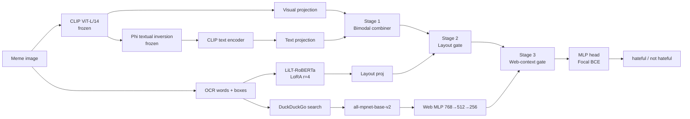

# WEAVE — Web-Enriched Attentive Visual-lingual Encoder for Harmful Meme Detection

> Multimodal hateful-meme classifier that extends **ISSUES** (Burbi et al., ICCVW 2023) with a **layout-aware OCR branch (LiLT + LoRA)** and a **web-context retrieval branch**, fused through a three-stage gated combiner.
> Bachelor's Thesis Project · PDPM IIITDM Jabalpur · Jan–May 2026

   

## Highlights

| Metric (Facebook Hateful Memes, `test_unseen`) | ISSUES (paper) | **WEAVE (ours)** |
|---|---|---|
| AUROC | 0.8551 | **0.8987** (+0.0436) |
| Accuracy | 77.70% | **81.35%** (+3.65 pp) |
| Trainable parameters | — | **20.1M / 591.8M (3.4%)** |

Full results across all splits:

| Split | Accuracy | AUROC | AP | F1 |
|---|---|---|---|---|
| dev_seen | 0.7700 | 0.8768 | 0.8732 | 0.7439 |
| dev_unseen | 0.8037 | 0.8757 | 0.8125 | 0.7181 |
| test_seen | 0.8030 | **0.9042** | 0.8978 | 0.7814 |
| test_unseen | **0.8135** | **0.8987** | 0.8429 | 0.7401 |

## Why

Memes combine an image, overlaid text, and cultural context. Existing detectors either treat modalities independently, ignore *where* text sits on the image, or have no world knowledge about the entities and slang referenced. WEAVE addresses all three.

## Architecture



**Four input branches**
1. **CLIP visual** — frozen CLIP ViT-L/14 features → trainable linear projection.
2. **Textual inversion (ISSUES core)** — frozen Phi network maps visual features to a pseudo-word token passed through the CLIP text encoder.
3. **LiLT layout branch (new)** — encodes OCR words *with their bounding boxes*; LoRA (r=4) on layout attention trains only 0.037M params.
4. **Web-context branch (novel)** — label-agnostic DuckDuckGo snippets embedded with `all-mpnet-base-v2`, giving the model external knowledge about entities, coded slurs and dog-whistles.

**Three-stage gated fusion** — each new modality is injected through a learned sigmoid gate `(1−g)·fused + g·branch`, so noisy OCR or generic web results can be muted per sample.

**Training** — Focal BCE (α=0.75, γ=2.0) + label smoothing + `pos_weight=2.0` for the ~35% hateful minority class.

## Ablation study (`test_unseen` AUROC)

| Configuration | AUROC |
|---|---|
| ISSUES (paper reference) | 0.8551 |
| v0 — CLIP + Phi + combiner, no layout / web | 0.7026 |
| v1 — LiLT full fine-tune (unstable) | 0.7134 |
| v2 — LiLT LoRA r=8 (overfits) | 0.7390 |
| v3 — Tri-modal CLIP + TI + LiLT r=4, no web | 0.7880 |
| v4 — Web context, no layout | 0.7660 |
| **WEAVE (final) — CLIP + TI + LiLT r=4 + Web** | **0.8987** |

Earlier exploration also replaced LiLT with **LayoutLMv3 + LoRA** (`notebooks/ablations/layoutlmv3_lora.ipynb`); LiLT was preferred as it has no redundant vision pathway (~70% fewer layout-branch parameters).

## Repository structure

```
weave-harmful-meme-detection/
├── notebooks/
│   ├── weave_train_eval.ipynb                 # ⭐ final WEAVE model: training + evaluation
│   ├── data_prep/
│   │   ├── 01_web_context_embeddings.ipynb    # DuckDuckGo retrieval → MPNet embeddings
│   │   ├── 02_ocr_split_chunks.ipynb          # chunked OCR pipeline (split)
│   │   ├── 03_ocr_process_chunk.ipynb         #   … run Tesseract per chunk
│   │   └── 04_ocr_merge_chunks.ipynb          #   … merge into one lookup
│   └── ablations/
│       ├── trimodal_clip_ti_lilt_lora.ipynb   # CLIP + TI + LiLT (no web context)
│       └── layoutlmv3_lora.ipynb              # LayoutLMv3 + LoRA variant
├── app/                                       # "Hateful Meme Shield" Chrome extension + Flask API
├── docs/WEAVE_BTP_Presentation.pptx
└── requirements.txt
```

## Getting started

The notebooks were developed on **Kaggle (Tesla T4, 16 GB)**.

1. Get the [Facebook Hateful Memes dataset](https://ai.meta.com/tools/hatefulmemes/) (also mirrored on Kaggle) and attach it to the notebook.
2. Obtain the pre-trained ISSUES Phi / projection weights from the [official ISSUES repo](https://github.com/miccunifi/ISSUES).
3. Run `data_prep/01_web_context_embeddings.ipynb` to build the web-context embedding cache, and the OCR notebooks to build the OCR + bounding-box cache.
4. Update the paths in the `Config` cell of `weave_train_eval.ipynb` and run all cells.

```bash
pip install -r requirements.txt
```

## Demo: Hateful Meme Shield (Chrome extension)

`app/` contains a Chrome extension that scans images on a page, sends them to a Flask endpoint wrapping the WEAVE model, and blurs memes predicted hateful. See [`app/README.md`](app/README.md).

## Limitations & future work

- Web retrieval adds pre-processing latency (mitigated by caching); generic OCR text can retrieve noisy snippets.
- OCR quality affects LiLT bounding boxes on stylised fonts.
- Evaluated on HMC only — cross-dataset evaluation on HarMeme is the next step.
- Planned: RAG-style explanations using retrieved snippets with a frozen LLM; multilingual MPNet for cross-lingual memes.

## Team

Bachelor's Thesis Project, PDPM IIITDM Jabalpur, under the guidance of **Dr. Ranjeet Kumar Ranjan**.

- Vusa Ganesh Ayyappa (22BCS272)
- **Jatothu Arun (22BCS113)**
- Miriyala Vithesh Krishna (22BCS161)
- Patchava Uma Mahesh Ajay (22BCS183)

## References

- G. Burbi et al., *Mapping Memes to Words for Multimodal Hateful Meme Classification* (ISSUES), ICCVW 2023 — [paper](https://arxiv.org/abs/2310.08368) · [code](https://github.com/miccunifi/ISSUES) (MIT License)
- D. Kiela et al., *The Hateful Memes Challenge*, NeurIPS 2020 — [arXiv:2005.04790](https://arxiv.org/abs/2005.04790)
- J. Wang et al., *LiLT: A Simple yet Effective Language-Independent Layout Transformer*, ACL 2022 — [arXiv:2202.13669](https://arxiv.org/abs/2202.13669)
- Y. Huang et al., *LayoutLMv3*, ACM MM 2022 — [arXiv:2204.08387](https://arxiv.org/abs/2204.08387)
- A. Radford et al., *CLIP*, ICML 2021 — [arXiv:2103.00020](https://arxiv.org/abs/2103.00020)
- G. K. Kumar & K. Nandakumar, *Hate-CLIPper*, 2022 — [arXiv:2210.14450](https://arxiv.org/abs/2210.14450)
- J. Mei et al., *Improving Hateful Meme Detection through Retrieval-Guided Contrastive Learning*, ACL 2024
- E. J. Hu et al., *LoRA*, ICLR 2022 — [arXiv:2106.09685](https://arxiv.org/abs/2106.09685)

Parts of the CLIP / textual-inversion / combiner pipeline are adapted from the ISSUES codebase (MIT License, © 2025 MICC – Università di Firenze).

> ⚠️ This project deals with hateful content. Dataset images are not redistributed here; notebook image outputs have been removed.
